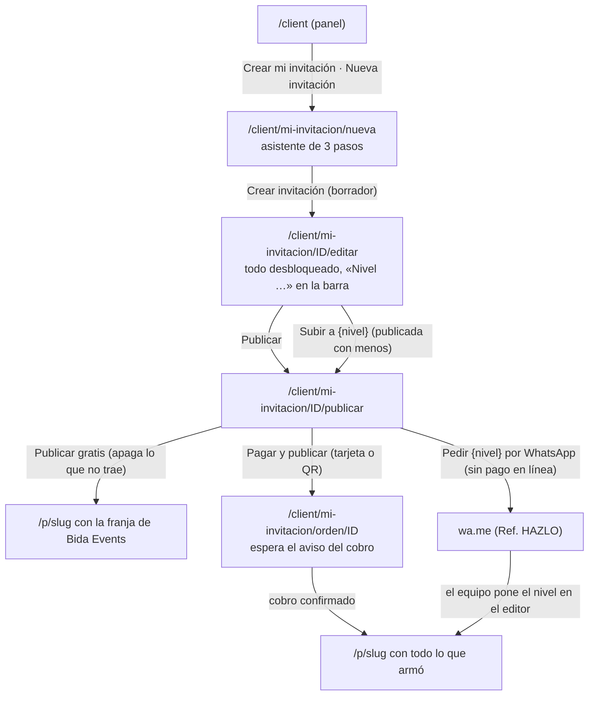
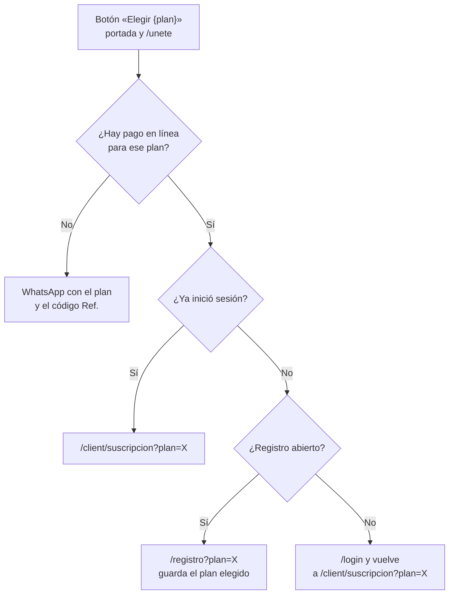
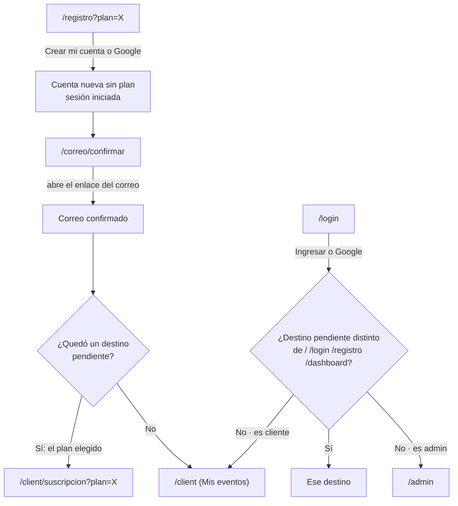
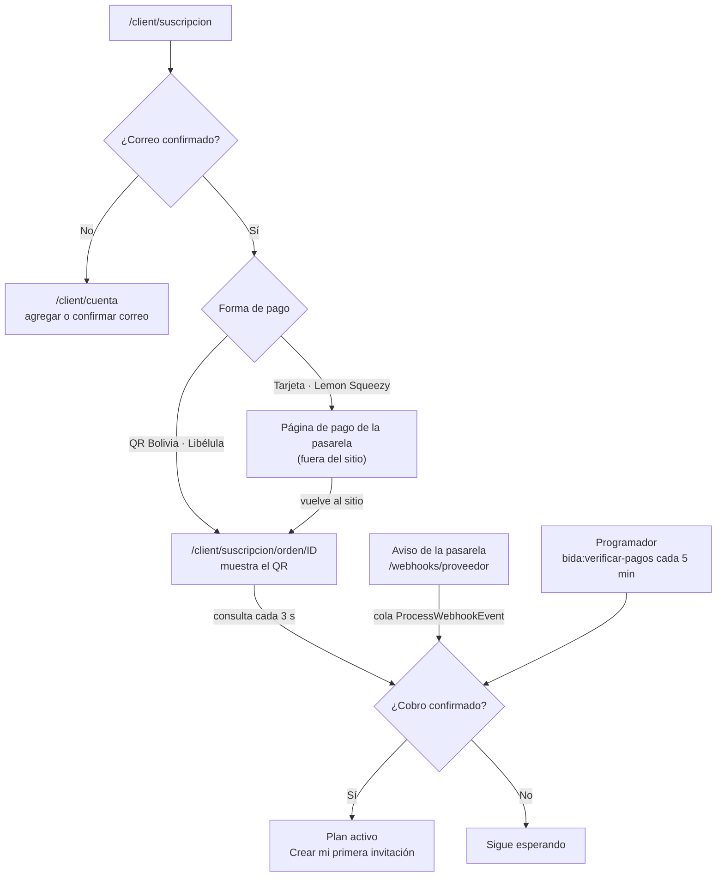
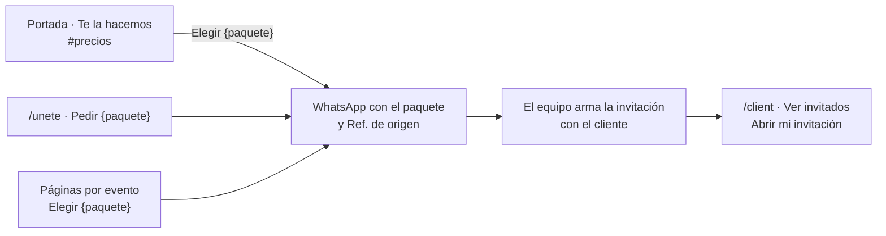

# Recorridos del sitio: a dónde lleva cada botón

Mapa de navegación de Bida Events con el modelo principal primero: **cada persona arma su propia
invitación gratis («Hazlo tú») y paga, una sola vez, solo si quiere más**. Lo adicional: los planes
para quien arma muchas («Únete») y que el equipo se la haga («Te la hacemos», pago único por
WhatsApp). Las tres formas están lado a lado en /precios.

Los diagramas se leen de arriba hacia abajo (o de izquierda a derecha en el último). Los nombres entre
llaves son datos que cambian: `{plan}`, `{paquete}`, `{evento}`, `{slug}`, `X` es la clave del plan.

## El recorrido principal

De cualquier página a la primera invitación publicada: crear la cuenta, confirmar el correo, armarla
y publicarla (gratis o con un pago único). «Crear mi invitación» (cabecera, portada, /precios) lleva
a `DiyInvitations::startUrl`: sin cuenta, a /registro?crear=1; con cuenta, al editor; un revendedor,
a su panel.

```mermaid
flowchart TD
  A["Cualquier página"] -->|"Crear mi invitación"| R["/registro?crear=1"]
  R -->|"Crear mi cuenta"| V["/correo/confirmar"]
  V -->|"enlace del correo"| N["/client/mi-invitacion/nueva"]
  N -->|"Crear invitación (borrador)"| E["/client/mi-invitacion/ID/editar"]
  E -->|"Publicar"| P["/client/mi-invitacion/ID/publicar"]
  P -->|"gratis o pagando su nivel"| L["/p/slug (enlace público)"]
  A -->|"Precios"| PR["/precios<br/>Hazlo tú · Planes · Te la hacemos"]
  PR -->|"Elegir {plan}"| RP["/registro?plan=X → pago del plan"]
```

## Hazlo tú: armarla sin pagar antes

Cualquier cuenta del sitio (que no sea revendedor) arma su propia invitación con todo desbloqueado. Al
publicarla, el nivel sale de las partes encendidas (`App\Support\DiyInvitations`): **Gratis** (portada,
cuenta regresiva y ubicación, con la marca de Bida Events a la vista, una por cuenta) o **Básico,
Estándar y Premium** (los mismos módulos que los paquetes del equipo), un pago único con tarjeta
(Lemon Squeezy) o QR (Libélula). Subir de nivel cobra la diferencia. Sin pago en línea, el nivel se
pide por WhatsApp y lo activa el equipo desde el editor del administrador.

- Hasta 3 borradores sin publicar a la vez (`bida.diy.drafts_limit`); un borrador se puede borrar desde el panel.
- Publicar exige el correo confirmado. La gratuita queda en línea hasta 7 días después del evento; la pagada, 30.
- Ya publicada, lo que se encienda por encima de su nivel no se ve hasta subirla de nivel.
- Precios: Admin › Ajustes › «Hazlo tú: publicar con cada nivel». Una temporada puede tener su precio
  único («Hazlo tú, precio único»): sus diseños se publican con todo por ese precio. Una tarjeta no tiene
  versión gratuita.

## Qué hace «Elegir {plan}»

Se venden tres planes (Inicial, Emprendedor y Agencia); Única y Aliado solo los renueva quien ya los
tiene. Sobre los planes, el selector Mensual / Cada 3 meses / Anual cambia el precio por mes y agrega
`meses=3` o `meses=12` a «Elegir», que llega hasta «Mi plan» con ese ciclo elegido.

El mismo botón lleva a tres lugares distintos según haya pago en línea, sesión iniciada y registro abierto.

## Entrar, registrarse y volver

Quien crea la cuenta sigue al pago del plan que eligió; quien ingresa vuelve a la página que quería abrir o a su panel.

## El pago y la activación del plan

El plan se activa cuando se confirma el cobro, por el aviso de la pasarela o por la verificación programada, no por volver a la página.

## Lo adicional: te la hacemos

Los paquetes no pasan por cuenta ni pago en línea: salen todos por WhatsApp y el equipo deja la invitación en el panel del cliente.

## Botón por botón

### Portada (`/`)

| Botón o enlace | Lleva a | Notas |
| --- | --- | --- |
| Logo | / | Vuelve a la portada |
| Plantillas · Qué incluye · Precios · Preguntas | #plantillas · #incluye · #precios · #preguntas | Anclas dentro de la misma página |
| Crear mi invitación (cabecera, en todas las páginas) | /registro?crear=1 · /client/mi-invitacion/nueva | Según haya sesión (`DiyInvitations::startUrl`) |
| Ícono de WhatsApp (cabecera) | wa.me con el mensaje y Ref. HOME | Acción secundaria |
| Ingresar / Mi panel | /login · /dashboard | Según haya sesión |
| Hazlo tú · Crear mi invitación gratis | /registro?crear=1 · /client/mi-invitacion/nueva | Primer bloque de servicios |
| Te la hacemos · Ver los paquetes | /precios#te-la-hacemos | Paquetes, pago único |
| Planes para profesionales · Ver los planes | /unete |  |
| Diseños de temporada | #temporada o la página de la temporada | Solo mientras la temporada se vende |
| Pestañas de evento (Pruébala como invitado) | /muestra/{slug} | Muestra interactiva, nada se guarda |
| Ver todos los diseños de {evento} | /invitaciones-de-{evento} | Página por evento |
| Así funciona · Crear mi invitación gratis | /registro?crear=1 · /client/mi-invitacion/nueva |  |
| Precios (resumen): Crear mi invitación gratis · Ver los paquetes · Ver los planes | el editor · /precios#te-la-hacemos · /precios#planes | Las tres formas en una fila |
| Ver todos los precios y qué trae cada nivel | /precios |  |
| Botón flotante de temporadas | Panel de la temporada → WhatsApp o su página |  |

### Precios (`/precios`)

| Botón o enlace | Lleva a | Notas |
| --- | --- | --- |
| Hazlo tú · Planes · Te la hacemos · Comparar · Preguntas (menú y entrada) | #hazlo-tu · #planes · #te-la-hacemos · #comparar · #preguntas |  |
| Crear mi invitación (cada nivel de Hazlo tú y cierre) | /registro?crear=1 · /client/mi-invitacion/nueva | El nivel no se elige antes: sale de las partes al publicar |
| Mensual · Cada 3 meses · Anual | Cambia el precio de los planes | `meses` viaja en «Elegir» |
| Elegir {plan} | Ver «Qué hace Elegir {plan}» |  |
| Elegir {paquete} | wa.me con el paquete y su precio (Ref. PRECIOS) | Primero el servicio: plazo, cambios y atención |
| Tengo una duda | wa.me (Ref. PRECIOS) |  |

### Únete (`/unete`)

| Botón o enlace | Lleva a | Notas |
| --- | --- | --- |
| Planes (menú) | #planes | Mismas columnas que los paquetes, con el detalle de cada plan |
| Plan {nombre} (en «Para quién») | #planes |  |
| Elegir {plan} | Ver «Qué hace Elegir {plan}» | Registro con el plan, pago o WhatsApp |
| Escríbenos (¿Necesitas algo distinto?) | wa.me con el mensaje de Únete (Ref. HAZLO) | Última celda de la cuadrícula |
| Pedir {paquete} | wa.me con el paquete | Lo adicional |
| Ver todo lo que incluye cada paquete | /precios#te-la-hacemos |  |
| Elegir mi plan (cierre) | #planes |  |
| Tengo una duda | wa.me con el mensaje de Únete (Ref. HAZLO) |  |

### Registro y correo (`/registro · /correo/confirmar`)

| Botón o enlace | Lleva a | Notas |
| --- | --- | --- |
| Crear mi cuenta | /correo/confirmar | Crea el usuario, envía el correo y deja la sesión iniciada |
| Entrar con Google | /auth/google → /auth/google/callback → destino pendiente o /client | Solo si hay credenciales de Google |
| Cambiar (plan elegido) | /unete#planes |  |
| Ingresa | /login |  |
| Términos · política de privacidad | /legal/terminos · /legal/privacidad |  |
| Enlace del correo | /client/suscripcion?plan=X · /client/mi-invitacion/nueva · /client | Al plan elegido si lo había; al editor si llegó por «Crear mi invitación» |
| Enviarme otro enlace | Misma página, con aviso | POST /correo/confirmar |
| Cámbialo en tu cuenta | /client/cuenta |  |
| Ir a mi panel | /dashboard → /client o /admin |  |

### Mi plan (pago) (`/client/suscripcion`)

| Botón o enlace | Lleva a | Notas |
| --- | --- | --- |
| Confirmar mi correo / Agregar mi correo | /client/cuenta | Hace falta para pagar en línea |
| Pagar (tarjeta) | Página de pago de Lemon Squeezy → /client/suscripcion/orden/ID | Se renueva sola cada mes, o cada 3 o 12 meses si el plan tiene la variante de ese ciclo |
| Pagar (QR Bolivia) | /client/suscripcion/orden/ID | Muestra el QR en bolivianos; se pagan 1, 3 o 12 meses de una vez |
| Administrar mi suscripción | /client/suscripcion/portal → portal de la pasarela | Solo con tarjeta |
| Crear mi primera invitación (plan activo) | /client/invitaciones/nueva | En la página de la orden |
| Ir a mi panel | /client |  |

### Panel del cliente (`/client`)

| Botón o enlace | Lleva a | Notas |
| --- | --- | --- |
| Nueva invitación (revendedor) | /client/invitaciones/nueva | Con plan activo; sin cupo igual arma borradores (el cupo cuenta las publicadas en el mes) |
| Crear mi invitación · Nueva invitación (Hazlo tú) | /client/mi-invitacion/nueva | Cualquier cuenta que no sea revendedor; hasta 3 borradores |
| Mira los planes mensuales (panel vacío) | /client/suscripcion o /unete#planes | La primera si hay pago en línea |
| Prefiero que me la hagan | /#precios |  |
| Borrar borrador | /client/mi-invitacion/{id} (DELETE) | Solo un borrador de Hazlo tú que nunca se publicó |
| Pagar ahora / Renovar | /client/suscripcion | Aviso de vencimiento |
| Ver invitados / Ver respuestas | /client/invitations/{id} |  |
| Editar | /client/invitations/{id}/editar · /client/mi-invitacion/{id}/editar | Revendedor al día · dueño de una de Hazlo tú |
| Abrir mi invitación · Copiar enlace | /p/{slug} | Solo si está publicada |
| Mi plan · Mi cuenta · Ver el sitio (menú) | /client/suscripcion o /unete#planes · /client/cuenta · / |  |

### Páginas por evento (`/invitaciones-de-boda, /invitaciones-xv-anos…`)

| Botón o enlace | Lleva a | Notas |
| --- | --- | --- |
| Crear mi invitación (cabecera) | /unete#planes |  |
| Ver los planes (aviso «¿Prefieres armarla tú?») | /unete#planes |  |
| Diseños (capturas) | /muestra/{slug} |  |
| Escríbenos · Elegir {paquete} | wa.me con el mensaje del evento | Código propio de cada página |
| La quiero por {precio} (temporada) | wa.me con el precio de temporada |  |

### Pie del sitio (`En todas las páginas`)

| Botón o enlace | Lleva a | Notas |
| --- | --- | --- |
| Invitaciones: Boda, XV años, Bautizo… | /invitaciones-de-{evento} | Las de temporada (Halloween, Día del Amor) no van fijas en el pie |
| Precios · Planes para profesionales · Guía de invitaciones | /precios · /unete · /guia-invitaciones-digitales |  |
| Mi panel / Ingresar | /dashboard · /login |  |
| Privacidad · Cookies · Términos | /legal/{página} |  |
| Escríbenos por WhatsApp · correo | wa.me · mailto |  |
| Instagram · Facebook · TikTok | Redes (sitio externo) |  |

## De dónde sale cada destino

- Lógica de los planes y de «Elegir»: `app/Support/DiyPlans.php`.
- Página de precios (las tres formas, la tabla de niveles y las preguntas): `app/Support/PricingPage.php`.
- «Crear mi invitación»: `App\Support\DiyInvitations::startUrl`.
- Portada: `app/Http/Controllers/HomeController.php` y `resources/views/home.blade.php`.
- Únete: `app/Http/Controllers/PublicPagesController.php` y `resources/views/unete.blade.php`.
- Cuenta y redirecciones: `RegisterController`, `VerifyEmailController`, `LoginController`
  (trait `RedirectsAfterLogin`) y la ruta `/dashboard` de `routes/web.php`.
- Pago: `app/Http/Controllers/Client/SubscriptionController.php` y `app/Payments`.
